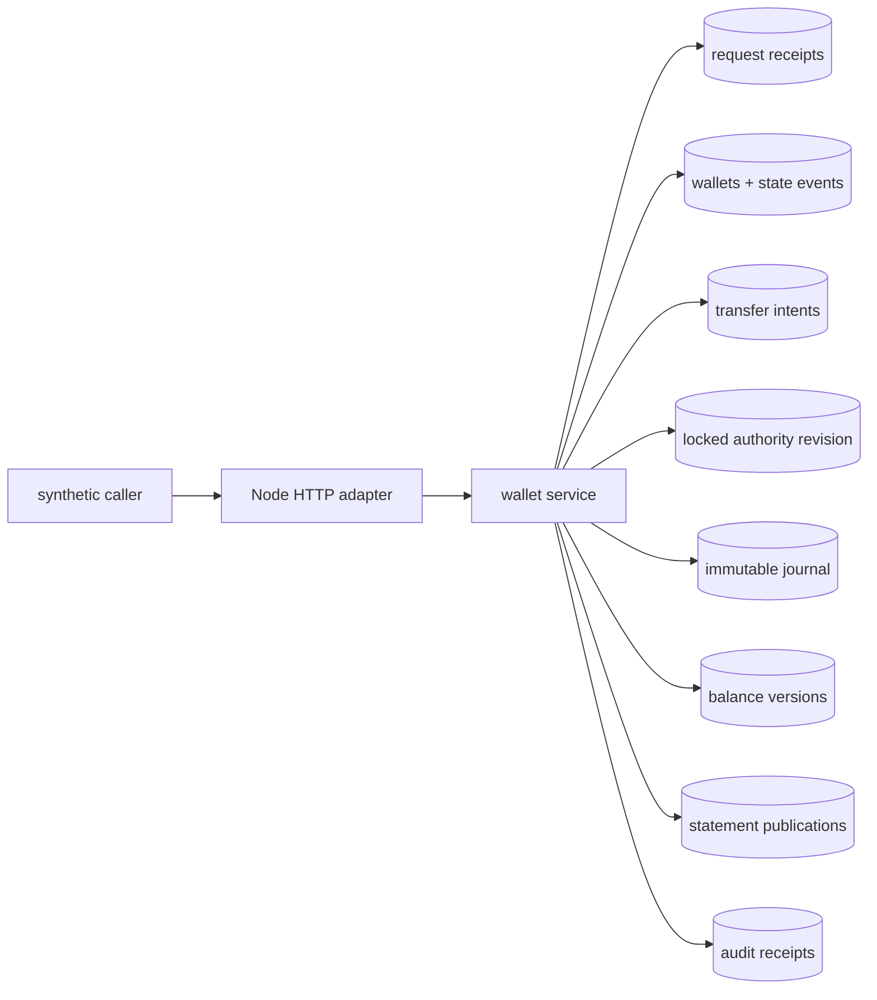

# Architecture

## Authority boundary



PostgreSQL 17 is the only local authority. The HTTP process has no correctness state that must survive restart. There is no external
processor, queue, cache, filesystem log, replica protocol, or hidden recovery worker.

## Authority order

An ordinary transfer post uses one transaction:

1. claim and lock `(operation, request_key)`; return the stored result on exact replay;
2. lock the prepared transfer identity;
3. lock both wallets in lexical `wallet_id` order;
4. recheck state, generation, asset, distinct identity, and source balance;
5. lock the singleton authority row and increment its revision;
6. insert the journal header and its source debit/destination credit;
7. update both wallet balances and append both balance versions;
8. mark the transfer posted and persist the canonical result;
9. commit, then return.

The authority row is deliberately locked after wallet rows. Every wallet-mutating path follows the same wallet-then-authority order.
This avoids making a PostgreSQL sequence gap or allocation race look like commit order. It also makes the lab a serialized revision
authority; it is not a throughput design for the chapter's hypothetical scale.

## State model

```text
wallet:   active --freeze--> frozen --activate--> active
                            frozen --close, zero/no prepared--> closed

transfer: absent --prepare--> prepared --post--> posted
                                      \--stable rejection--> prepared

reversal: absent --validate current holder--> posted compensating transfer
                                      \--stable rejection--> absent
```

Every wallet state transition increments generation and appends a wallet event at an authority revision. A prepared transfer stores
the source and destination generations it observed. A later freeze/reactivation permanently fences that intent, even if the wallet is
active again.

## Journal invariant

For transaction amount `x`:

```text
source entry      delta = -x
destination entry delta = +x
sum(delta)              =  0
```

A deferred PostgreSQL constraint trigger validates the two rows at transaction end. A second trigger prevents update/delete of
journal facts. This is a narrow balanced transfer journal. It does not classify assets, liabilities, equity, income, or expense and
therefore does not claim complete double-entry accounting.

## Genesis and supply

Migration creates one `treasury` wallet with `10_000_000 LAB`, authority revision 1, a genesis wallet event, and a genesis balance
version. User wallets start at zero. No API mints or burns. Consequently, if every later journal transaction sums to zero, total
materialized balance should remain the genesis supply. Audit recomputes this claim rather than trusting the projection.

## Statements

A statement publication runs in one Repeatable Read transaction. It selects a wallet and explicit/current `as_of_revision`, resolves
the wallet generation at that cut, copies all qualifying entries into immutable ordered statement items, and stores their canonical
digest and computed closing balance. Order is `(authority_revision, journal_entry_id)`.

A page cursor encodes statement identity, publication digest, and next ordinal. Pages read copied items rather than a live journal.
Later transfers therefore cannot appear between pages. Page result receipts are retained to make exact readback testable; they are not
proof a person saw the page.

## Audit

Audit also runs in Repeatable Read and binds one authority cut. For each wallet existing at that cut it calculates:

```text
recomputed = initial_balance + sum(journal delta through cut)
```

It compares that value with the latest append-only balance version through the cut. At the current cut it additionally compares the
mutable wallet projection. It checks entry pairing, transaction balance, and total supply, then stores a pass/fail receipt with counts
and digests. A failed audit reports evidence; it never repairs or hides the mismatch.

## Failure boundaries

| Boundary | Durable fact after restart |
|---|---|
| before transaction commit | no success receipt and no partial authority effect |
| commit succeeds, process dies before response | exact request finds and returns stored terminal result |
| concurrent same request | one transaction owns the request row; the other replays or conflicts |
| concurrent spend | source row lock makes affordability decisions sequential |
| freeze versus post | wallet row lock gives one authority order; stale generation cannot post afterward |
| statement versus transfer | publication sees one Repeatable Read cut |
| audit versus transfer | audit sees one complete cut, never one journal leg |

Process `SIGKILL` tests cover commit-before-response. They do not cover kernel panic, power loss, storage-controller cache, database
failover, split brain, restore, or regional disaster.
